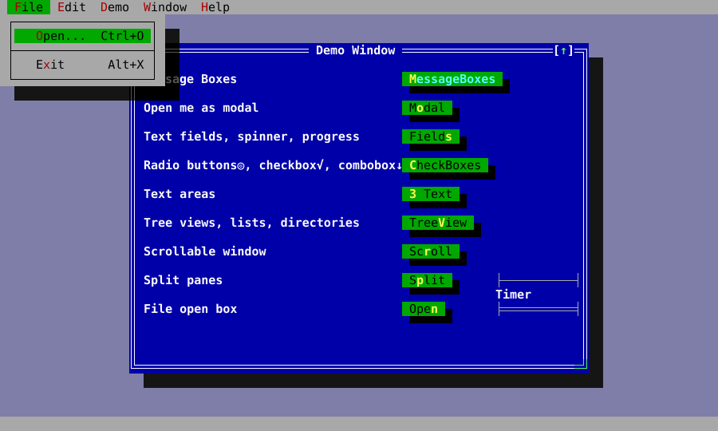
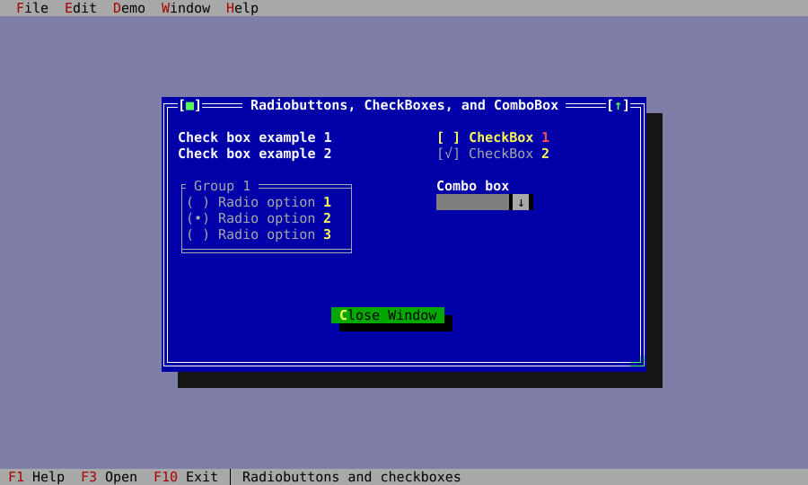
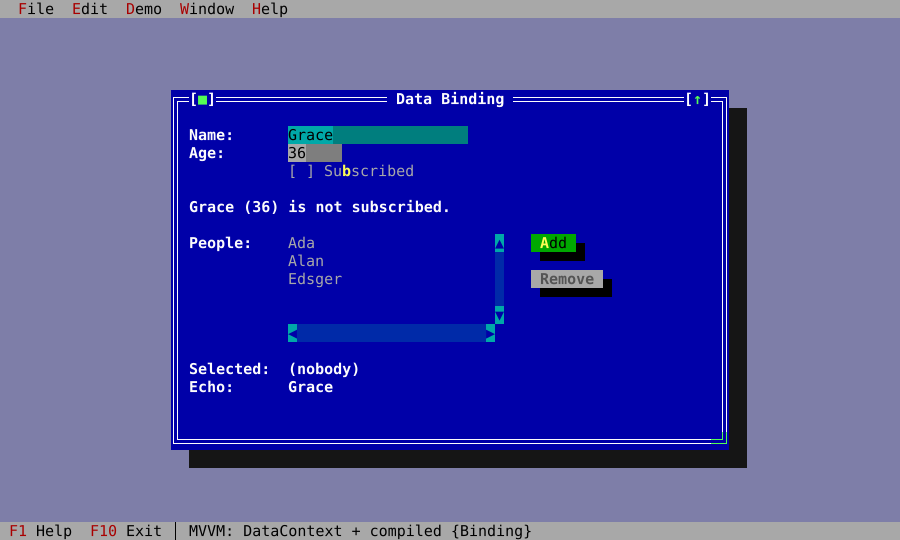
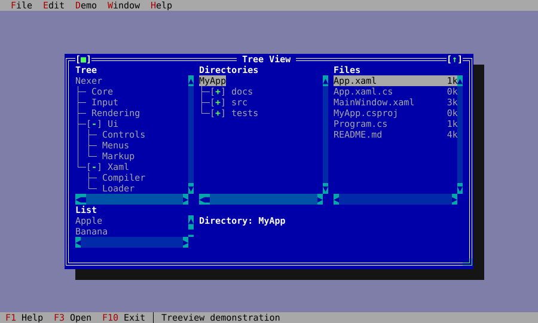

# Nexer

[](https://github.com/oising/Nexer/actions/workflows/ci.yml)

**Build classic text-mode apps for modern terminals in .NET 10, with XAML.** Nexer gives you overlapping windows,
menus, dialogs, a status bar and a full widget set in the spirit of Turbo Vision and
[Jexer](https://gitlab.com/AutumnMeowMeow/jexer). You describe the UI in XAML, which is compiled at build time,
and bind it to view models with MVVM. It runs in any VT terminal with keyboard and mouse.



| Check boxes, radio buttons, combo box | Data binding with validation | Trees, directory and file lists |
|:---:|:---:|:---:|
|  |  |  |

## Quick start

```xml
<Project Sdk="Microsoft.NET.Sdk">
  <PropertyGroup>
    <OutputType>Exe</OutputType>
    <TargetFramework>net10.0</TargetFramework>
  </PropertyGroup>
  <ItemGroup>
    <PackageReference Include="Nexer.Ui" Version="1.0.0-preview.1" />
    <PackageReference Include="Nexer.Xaml" Version="1.0.0-preview.1" />
  </ItemGroup>
</Project>
```

Write a window in XAML (`HelloWindow.xaml`) with a partial code-behind class:

```xml
<Window xmlns="https://nexer.dev/ui" xmlns:x="http://schemas.microsoft.com/winfx/2006/xaml"
        x:Class="MyApp.HelloWindow" Title="Hello" Width="30" Height="8" Centered="True">
  <Label X="2" Y="1" Text="Hello, Nexer!" />
  <Button X="10" Y="3" Text="&amp;OK" Click="OnOk" />
</Window>
```

```csharp
public partial class HelloWindow : Window
{
    public HelloWindow() => InitializeComponent();   // generated from the XAML
    private void OnOk(object? sender, EventArgs e) => Close();
}

// Program.cs
var app = new Application();
app.Windows.Add(new HelloWindow());
await using var host = await ConsoleTerminalHost.StartAsync(new ConsoleTerminalHostOptions());
await app.RunAsync(host);
```

To see everything in action, run the demo in Windows Terminal or any other VT terminal:
`dotnet run --project samples\Nexer.Demo`. F10 or Alt+letter opens the menus, F6 switches windows and Alt+X exits.

## Controls at a glance

| Category | Controls |
|----------|----------|
| Application | `Application` (menu bar, desktop, status bar, themes), `Window`, `ScrollableWindow`, `Desktop` |
| Input | `Button`, `CheckBox`, `RadioGroup` + `RadioButton`, `Field`, `PasswordField`, `ComboBox`, `Spinner` |
| Display | `Label`, `Text` (scrolling, word-wrapped), `ProgressBar` |
| Lists and trees | `List`, `TreeView` + `TreeItem`, `DirectoryTreeItem`, `DirectoryList` |
| Layout | `Panel`, `SplitPane`, `HScroller`/`VScroller`, `BoxLayout`, `AnchorLayout`, `StretchLayout` |
| Menus and status | `Menu`, `MenuItem`, `SubMenu`, `MenuSeparator`, `StatusBar` + `StatusKey`, keyboard accelerators |
| Dialogs | `MessageBox`, `InputBox`, `FileOpenBox`, modal windows (`await window.ShowModalAsync<T>()`) |

Windows can be moved, resized, zoomed, tiled and cascaded, and can be translucent. All of this works from the keyboard and
the mouse. See [docs/controls.md](docs/controls.md) for the full API.

## XAML and data binding

- **Compiled at build time.** Every `.xaml` file is compiled into your assembly. You don't need a runtime parser or
  reflection, and XAML mistakes fail the build with file and line numbers.
- **Typed code-behind.** Each `x:Name` becomes a field, and `InitializeComponent()` is generated for you.
- **Compiled bindings.** `{Binding}` is checked against `x:DataType`, so a typo in a member name is a build error.
  Bindings support two-way binding, converters, `StringFormat`, `ElementName`/`RelativeSource`, validation,
  `ItemsSource` with `ObservableCollection`, and `ICommand`. Changes made to a view model on another thread are
  marshalled to the UI thread for you.

```xml
<Window xmlns="https://nexer.dev/ui" xmlns:x="http://schemas.microsoft.com/winfx/2006/xaml"
        xmlns:local="clr-namespace:MyApp" x:Class="MyApp.PersonWindow" x:DataType="local:PersonViewModel">
  <Field Text="{Binding Name}" Width="20" />
  <List Y="2" Height="5" ItemsSource="{Binding People}" DisplayMemberBinding="{Binding Name}"
        SelectedItem="{Binding Selected}" />
  <Button Y="8" Text="&amp;Remove" Command="{Binding RemoveCommand}" CommandParameter="{Binding Selected}" />
</Window>
```

```csharp
app.Windows.Add(new PersonWindow { DataContext = new PersonViewModel() });
```

See [docs/xaml.md](docs/xaml.md) and [docs/binding.md](docs/binding.md).

## Develop and test without a terminal

`Nexer.Ui.Testing` runs your whole application headlessly. You can script keys, typing and mouse clicks, then check
the rendered screen, so UI tests run in CI like any other unit test:

```csharp
var driver = new UiDriver(new MyApplication(), 80, 25);
driver.Press("Alt+F");                       // open the File menu
Assert.Contains("Exit", driver.Text());      // the screen as text
var style = driver.Style(1, 0);              // colours and attributes of any cell
```

- **`--smoke`.** `dotnet run --project samples\Nexer.Demo -- --smoke` builds every demo window headlessly, renders
  one frame of each and exits 0. Add `--dump` to print the frames as text. It's a quick check that nothing
  throws and everything draws, and CI runs it on every pull request. Add the same switch to your own app's `Program.cs`
  (an interactive terminal isn't always available, for example in CI or for coding agents).
- **Screenshots.** `ScreenDump.Svg(driver.Frame)` turns any frame into an SVG with the real colours, like the
  images above. They are generated by `dotnet run --project samples\Nexer.Demo -- --screenshots docs\images`.
- **Coding agents.** The [`nexer-tui` skill](.github/skills/nexer-tui/SKILL.md) teaches agents to build, bind and
  test Nexer apps headlessly. It includes a ready-to-use starter template.

## Packages

| Package | Use it for |
|---------|------------|
| `Nexer.Ui` | The widget toolkit. It brings in the terminal host and the VT layers. |
| `Nexer.Xaml` | Compiling `.xaml` at build time and generating code-behind (a development dependency). |
| `Nexer.Ui.Testing` | Running applications headlessly in tests, and exporting SVG screenshots. |
| `Nexer.Xaml.Loader` | Loading XAML text at runtime. |

The underlying VT layers (cell surfaces, input decoder, diffing renderer, console host and a headless terminal
emulator) are separate packages with no dependencies, so you can use them on their own. See [docs/core.md](docs/core.md).

## Learn more

- [Controls](docs/controls.md), [XAML](docs/xaml.md), [data binding](docs/binding.md)
- [Architecture and repository map](docs/architecture.md), [backend: input, rendering and hosting](docs/backend.md),
  [VT layers](docs/core.md), [terminal compatibility](COMPATIBILITY.md)
- [Contributing: build, test, CI and releases](CONTRIBUTING.md)

## License

MIT (see [LICENSE](LICENSE)). The ported Jexer code is MIT © Autumn Lamonte. See `THIRD-PARTY-NOTICES.txt` for the Unicode data.
